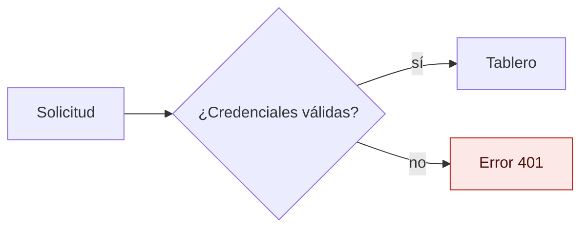
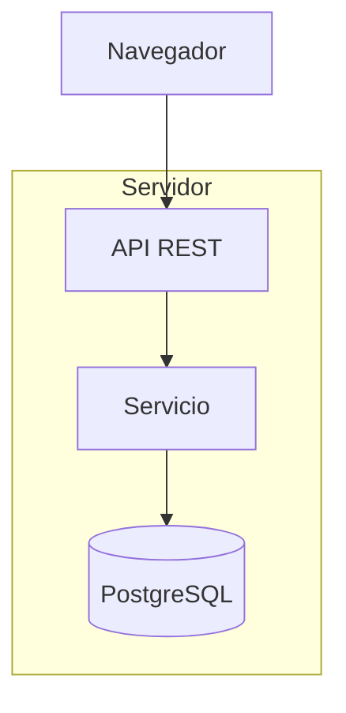
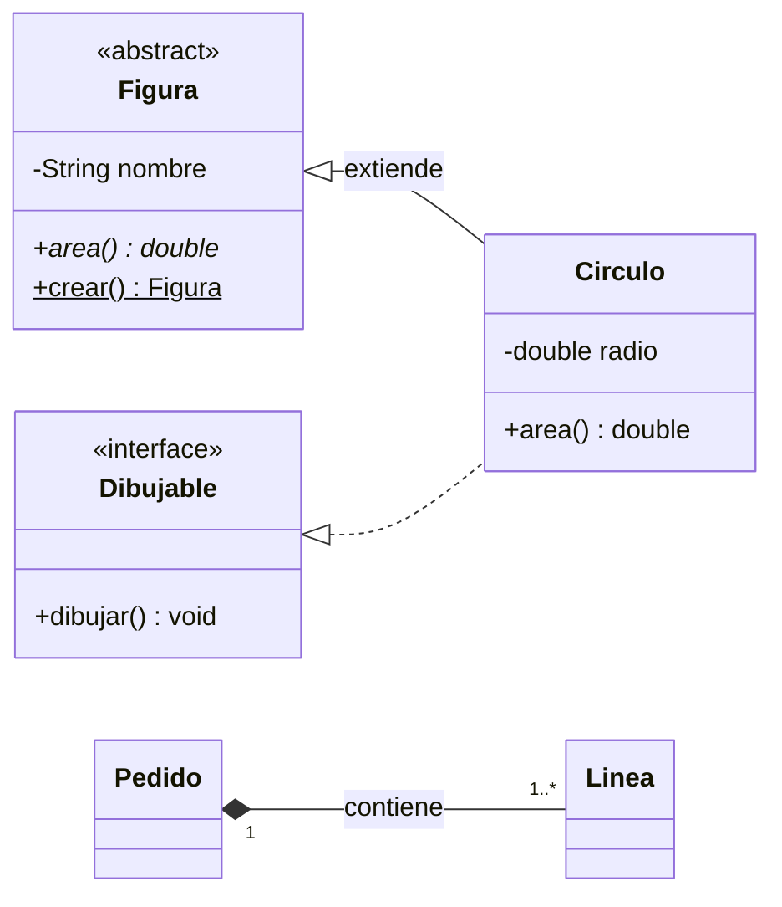
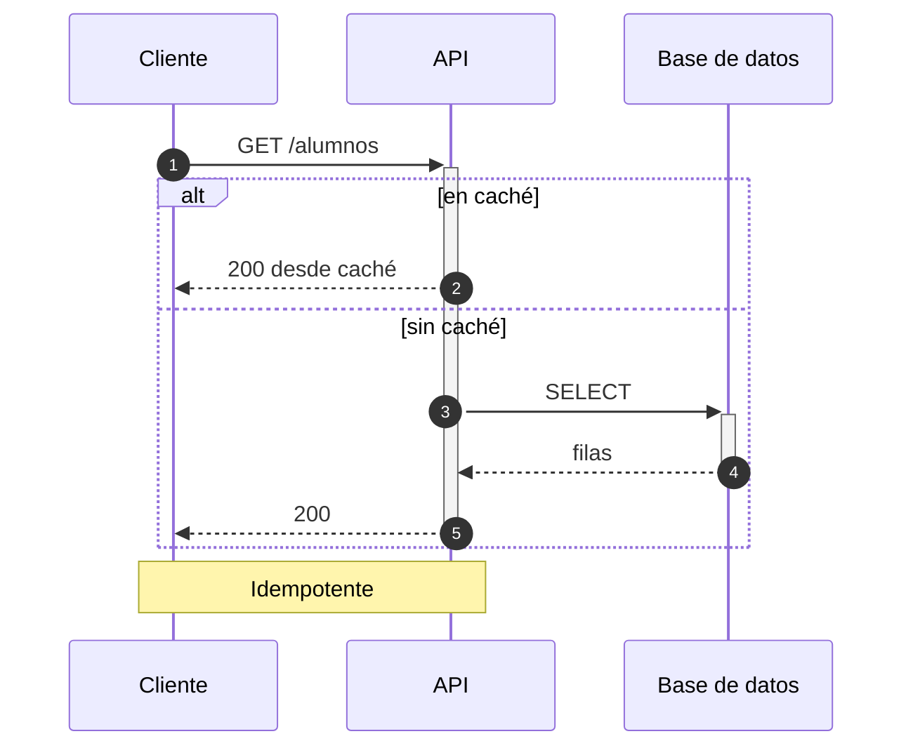
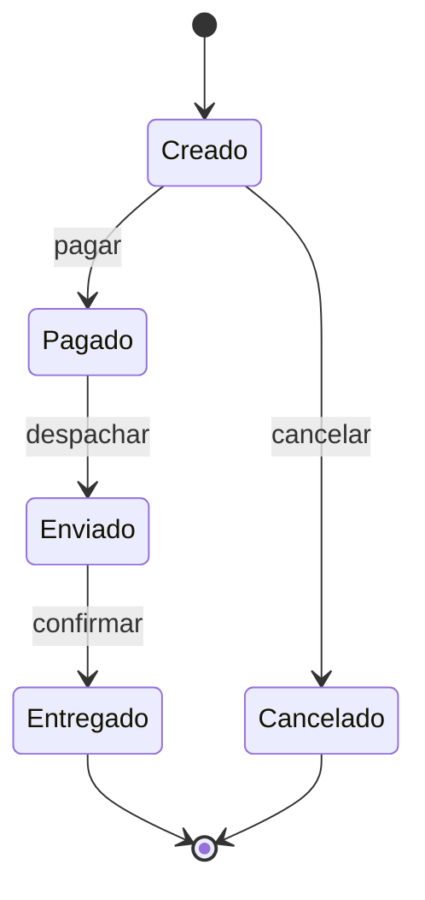
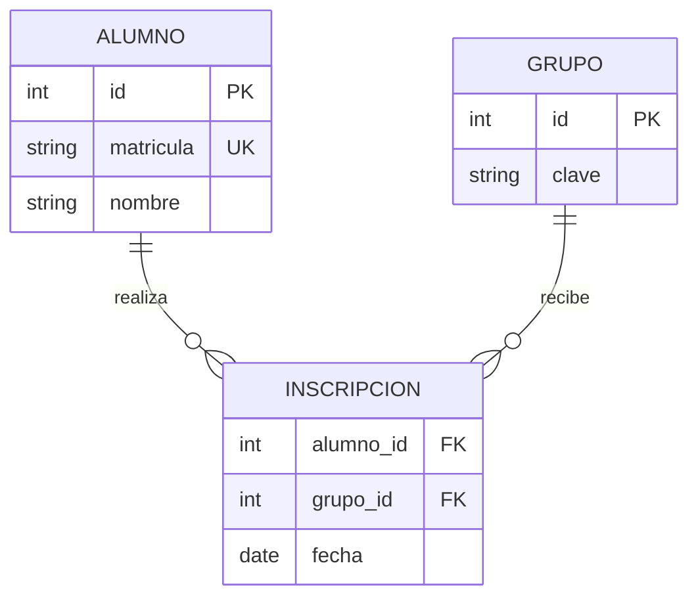
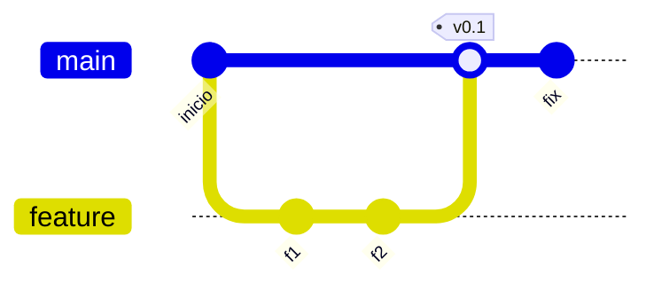
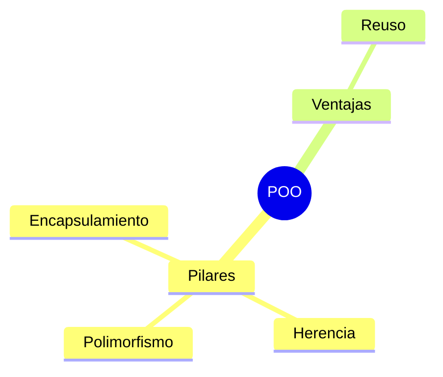
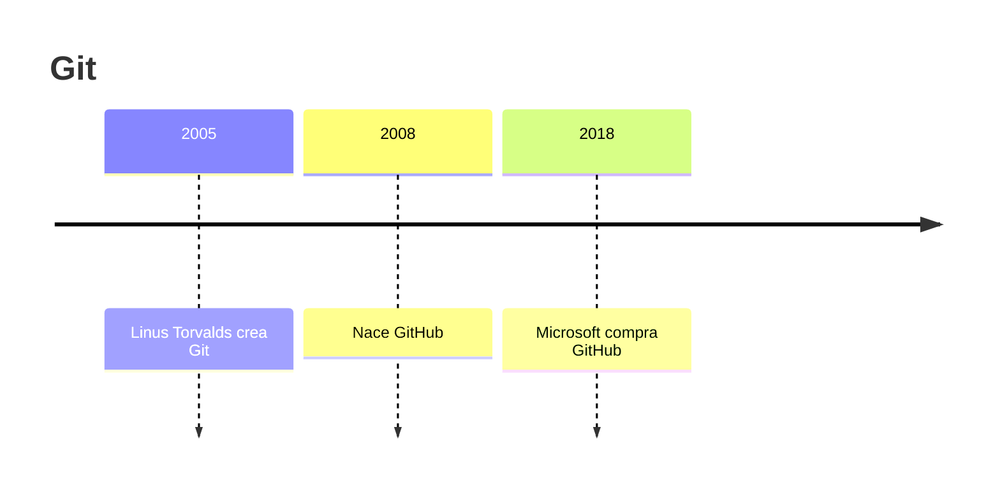

# Cheatsheet por tipo (Mermaid 11.4.1)

Cada ejemplo está validado con `uv run mermaid-check`. Todos llevan `accTitle` y `accDescr` justo después de la palabra clave. Los ejemplos pasan sin errores; `mermaid-check` puede avisar `small-text` en sequence, class, ER y gitGraph porque son anchos o altos: en tus diapositivas usa menos nodos o etiquetas más cortas hasta que el aviso desaparezca.

## flowchart: procesos y algoritmos

Usa `flowchart` (no `graph`). `LR` para flujos de ≤ 6 nodos; `TB` para pasos secuenciales largos. IDs estables y etiqueta entre comillas: `userSvc["Servicio de usuarios"]`.

Formas útiles: `[rect]`, `(redondeado)`, `{decisión}`, `[(base de datos)]`, `((círculo))`, `[[subrutina]]`. Subgrafos para agrupar capas:

Errores comunes: `end` en minúscula como texto (usa `End` o `"end"`); `A---oB` se vuelve arista con círculo (deja espacio: `A --- oB`); paréntesis sin comillas dentro de `[...]`; `linkStyle N` cuenta aristas desde 0 en orden de definición.

## classDiagram: UML estático

Visibilidad `+` público, `-` privado, `#` protegido, `~` paquete. Sufijos: `*` abstracto, `$` estático. Sin `()` es atributo. Genéricos con `~T~` (no con `<T>`). Estereotipos: `<<interface>>`, `<<abstract>>`, `<<enumeration>>`.

| Relación | Sintaxis |
|---|---|
| Herencia | `A <\|-- B` |
| Realización (implementa) | `A <\|.. B` o `B ..\|> A` |
| Composición | `A *-- B` |
| Agregación | `A o-- B` |
| Asociación | `A --> B` |
| Dependencia | `A ..> B` |

Cardinalidad entre comillas: `Order "1" *-- "1..*" Line : contiene`.

Máximo 6 clases por diapositiva; muestra solo atributos y métodos relevantes para la idea.

## sequenceDiagram: interacción en el tiempo

`participant X as Alias` fija el orden. `->>` solicitud, `-->>` respuesta, `->>+` / `-->>-` activan y desactivan. Bloques: `alt/else`, `opt`, `loop`, `par`, `critical`, `break`, cerrados con `end`. `Note over A,B: texto`.

Errores comunes: `;` termina la sentencia (usa `#59;` en el mensaje); `end` como texto de mensaje; colores de `box` requieren `rgb()`.

## stateDiagram-v2: ciclo de vida

`[*]` inicio/fin. Estados con nombre largo: `state "Texto largo" as id`. Compuestos con `state X { ... }`; no hay transiciones entre internos de compuestos distintos.

## erDiagram: modelo de datos

Cardinalidad (lado izquierdo / derecho): `||` exactamente uno, `|o` cero o uno, `}o` cero o más, `}|` uno o más. `--` identificante, `..` no identificante. Atributos: `tipo nombre PK|FK|UK`.

No uses `?` para nulos (llega en v11.16); documenta la opcionalidad con la cardinalidad.

## gitGraph: ramas y fusiones

`commit`, `branch x`, `checkout x`, `merge x`, `cherry-pick id:"..."`. Etiqueta con `commit id:"f1" tag:"v0.1"`.

## mindmap y timeline (breve)

`mindmap` en 11.4.1 no admite `accTitle`/`accDescr` (rompe el parser): descríbelo en el `figcaption` o `aria-label` de la diapositiva; `mermaid-check` avisará de la ausencia y es esperable.

## Principales trampas

1. `end` en minúscula dentro de flowchart/sequence rompe el parser.
2. Etiquetas con `()[]{}:;#"/<>` sin comillas.
3. Colores con `var()` o nombres: Mermaid solo acepta hex en `themeVariables` y `classDef`.
4. Más de 12 nodos (6 clases): no se lee en proyector; divide.
5. Usar sintaxis de v12 (radar, treemap, `look: neo`, `autonumber start step`, ER `?`): no existe en 11.4.1.
